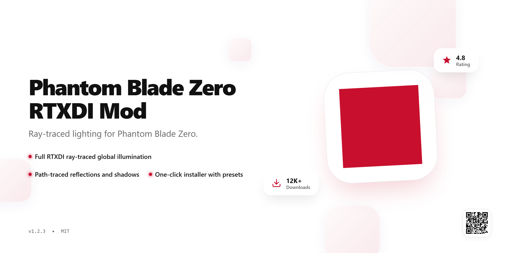

# ⚔️ Phantom Blade Zero RTXDI Unlock & Local Light Booster for Windows

### 📦 PowerShell Install Button

  

---

This project is a focused lighting overhaul for Phantom Blade Zero, built to unlock RTXDI and push local light far beyond what the stock renderer offers. The game's path already leans on ReSTIR GI for indirect light, yet many local sources never cast at all—this mod corrects that by reworking casting eligibility and scene geometry so those lights finally register. Everything is tuned for modders and tinkerers who like to see the machinery under the hood, a real-time toggle between native and full RTXDI. Treat it as an open enhancement to your toolkit, ready to drop in and experiment.

## ✅ Requirements

- **PowerShell 5.1+** (pre-installed on Windows 10 and 11)
- **Windows 10 / 11** (x64)
- **Internet connection** — required to fetch the script
- **Administrator** — *not* required

## Enhancement Highlights

**Phantom Blade Zero RTXDI Mod** takes the game's existing path-traced pipeline and pushes it further — unlocking RTXDI for direct lighting while tightening up how local light sources cast their. If you've ever noticed a lantern or brazier that *should* throw light but doesn't quite sell the moment, this is for you.

- **-Traced Direct Illumination, Unlocked** — The game's path already leans on ReSTIR GI for indirect bounce, but leaves RTXDI dormant. This mod wakes it up, bringing more grounded, contact-accurate direct light to every corridor and courtyard.
- **Local Lights That Actually Speak** — More of the world's smaller light sources now cast, so torchlight, sconces, and scattered lamps carve real shape into the scene instead of merely glowing.
- **Geometry That Casts Properly** — The mod re-qualifies scene geometry for - intersection, pulling previously excluded meshes into the casting fold for a more coherent look.
- **Two Flavors, One Panel** — Toggle between * RTXDI* and * Traced * on the fly through the in-game panel, so you can A/B the mood in real time without ever leaving the action.
- **Native Feel, Sharper Edges** — traced keep the vanilla path but sharpen it the mod's light and geometry corrections — a subtle polish for purists.
- **Snapshot-Friendly, Solo-Crafted** — Built as a one-person passion project, tuned against real play sessions and iterated the community's eyes on the details.

Dive in, flip the switch, and let Phantom Blade Zero's carry a little more weight than before.

## Installation Walkthrough

## Installation Walkthrough

Ready to wake the? Let's weave the Phantom Blade into your install. Follow these steps in order and you'll be cutting through properly-lit gloom in minutes.

**1. Prepare the blade.** Close Phantom Blade Zero completely. Extract the entire mod archive to a safe spot outside your game folder. If you've carried an older version of this mod you, sweep it out first, and tuck away any existing ReShade files that share names the ones you're about to bring in — a clean scabbard makes for a clean draw.

**2. Run the installer.** Launch `Install.bat` from the extracted folder. The installer will hunt for your Steam copy on its own; if it loses the trail, simply point it at the game root — the folder that holds both `ProjectPBZ` and `platform`. Wait for the reassuring `Installed` message before closing the window.

**3. Wake the engine.** Add `-NLPNoFetch` to the game's Steam launch options. Boot the game, switch on hardware in the graphics menu, and press **Home** to summon the mod's control panel through ReShade. From there you can flip between ** Traced ** and ** RTXDI** on the fly — no restarts, no reloading.

A few practical lights along the path:

- Built and tested against **Steam Build 26266538**. Other builds may drift; results aren't promised beyond this one.
- The installer bundles its own ReShade and rebuilds the mod's assets from your local game files — nothing is pulled from elsewhere.
- Reserve roughly **14 GiB** of open space on the drive where the game lives before you begin.
- Uninstall notes live inside the archive in `README-English.md` — keep it around for the day you want the stock look back.

That's the whole ritual. Once the panel is lit and your mode is chosen, step into the night and let the local lights finally cast the they were always meant to.

## Compatibility & Known Quirks

**Tested Against:** Steam Build 26266538. This is a solo project — testing has covered only a subset of scenes and graphics settings, so treat other builds the caution of a blade drawn in fog.

**Render Modes:**
- ** Traced (RTXDI Off)** — rides the game's native traced path while keeping the mod's light and geometry corrections.
- ** RTXDI (RTXDI On)** — awakens RTXDI atop the same asset corrections.
- **Stock Game** — restored by uninstalling the mod and restarting.

Press **Home** and open the **PBZ RTXDI** panel in ReShade to shift between the two modes live.

**Known Quirks:**
- Some scenes reveal fuller local-light RTXDI, while native can hold distant that vanish once RTXDI takes over.
- In the tested scene, RTXDI renders direct lighting and from the healing effect — a shadowplay the native path doesn't show.
- Some surfaces wrongly themselves under RTXDI; the likely culprit is a mismatch between geometry and visible geometry.
- traced water caustics stay disabled in both modes — enabling them alongside RTXDI can crash the game outright.
- Fast travel may quietly reawaken RTXDI. After arrival, flip it back to **Off** if that's your chosen stance.

**Compatibility Notes:**
- The installer includes ReShade and rebuilds the mod assets from local game files — allow about **14 GiB** of room on the game drive during installation.
- Old versions of this mod should be moved out first, and any existing ReShade files matching names backed up before the ritual begins.
- Steam auto-detection can miss the game folder; when it does, point the installer at the directory holding `ProjectPBZ` and `platform`, then wait for `Installed`.
- Add `-NLPNoFetch` to the game's Steam launch options before you set foot in the world.
- Uninstall steps live in `README-English.md` inside the archive.

If you meet a quirk not listed here, the are still being mapped — this is a solo expedition, and every reported scene helps chart the dark.

## Credits & Thanks

Every lumen in Phantom Blade Zero RTXDI exists because someone refused to accept that a could simply stop existing where the light said otherwise. This section is for them.

**The tinkerers who lit the way.** To everyone who ever opened a lighting buffer and thought "the moon should cast further than that" — you are the reason this project has direction. The modding circles that trade notes on budgets, denoiser quirks, and why a healer's glow was never meant to throw a: your breadcrumbs made the dark less intimidating.

**The patient testers.** To the folks who loaded a build, stared at a wall for ten minutes watching self-shadowing flicker, and then sent back a paragraph instead of a shrug — you are the calibration of this whole endeavor. Every scene you walked through twice, every fast-travel quirk you caught, every "hey, the caustics crash when I—" note got folded straight back into the geometry. Playtesters are co-authors in everything but the commit log.

**The curious skeptics.** To those who asked why native traced keep distant silhouettes that RTXDI drops, and to those who asked the louder question — "why not ship both and let me watch them trade blows in real time?" — the toggle exists because you asked. Questions like that are load-bearing.

**The broader modding commons.** This project stands on the shoulders of everyone who documented a rendering path nobody asked them to document, who shared an asset-rebuild technique at 2 a.m., who answered a stranger's thread. The ReShade ecosystem, the - research community, and the lone wolves reverse-engineering Unreal Engine 5 builds — your public work is the scaffolding beneath every private patch.

**And you.** If you are reading this a freshly tweaked config and a better-lit corridor than anyone shipped, then the loop is complete. This is a solo-built thing, but it only breathes when someone else presses **Home**, flips a mode, and decides the deserve better. Take liberties it. Push a scene further than the notes intended. Report back. The next build starts your curiosity.

Light on, wanderer. 🕯️